  

  I build production web and mobile applications that turn business needs into reliable software.

  
  

---
 
## About me
 
I work across the full development lifecycle, from intuitive React frontends to robust Django and REST API backends and cross-platform mobile apps with Flutter. I care about clean, maintainable code and about understanding the business behind the product.
 
- **Payments:** integrated 10+ payment providers across LATAM (cards, bank transfers, cash payments and wallets) with webhook-driven workflows in fintech.
- **Quality:** automated testing and CI/CD pipelines with GitHub Actions.
- **Delivery:** shipping dockerized apps and APIs to production.

---
 
## Tech stack
 
**Backend** 

 
**Frontend** 

 
**Mobile** 

 
**Tools & Deployment** 

---
 

  📫 <b>dsvera174@gmail.com</b>

